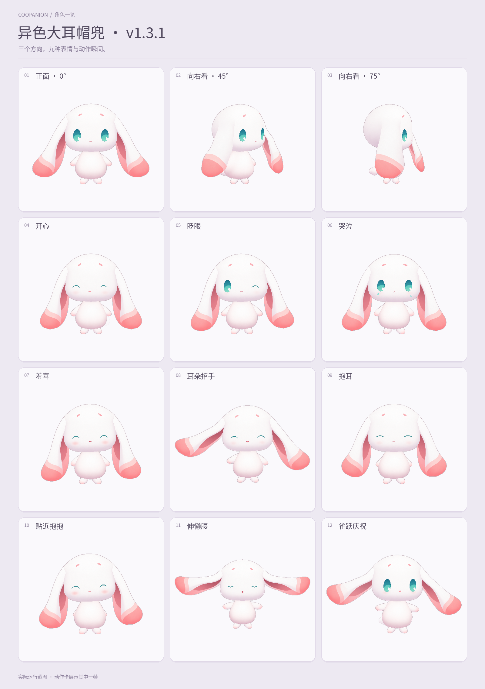

# 异色大耳帽兜 · Coopanion v1.3.1

为 Coopanion 制作的非官方第一阶段异色大耳帽兜角色。工程包含完整生成原图、分层 PNG、2048×2048 图集、网格与动画源码、本地预览，以及旧版 Coopanion 宿主的鼠标释放修复补丁。

运行格式是 **Coopanion `manifest: 2 / api: 2`**。本项目采用绘画分层与网格动画，不包含 Cubism `moc3`、`model3.json` 或 Cubism Editor 工程。左右侧转覆盖约 **−75° 至 +75°**，不是完整 360° 模型。

> v1.3.1 已完成最终导入、转向、走跑与停步、离线预览验证。实际范围、原始报告及源码哈希见 [验收入口](docs/qa/acceptance.md)。可直接使用的两个文件位于 `dist/`。



图册由实际运行截图排版；动态走跑以最终预览与验收记录为准。

## 安装到 Coopanion

可直接下载，无需安装开发环境：

- [角色安装 ZIP](https://github.com/YuZhou0311/maodou-coopanion/raw/refs/heads/main/dist/Maodou-Coopanion-v1.3.1.zip)
- [离线预览 HTML](https://github.com/YuZhou0311/maodou-coopanion/raw/refs/heads/main/dist/Maodou-Offline-Preview-v1.3.1.html)：保存为 `.html` 后双击打开。

仓内文件与 SHA-256 见 [dist/README.md](dist/README.md)。离线预览不用安装 Coopanion，也不依赖网络。

1. 使用构建得到的 `Maodou-Coopanion-v1.3.1.zip`，保持 ZIP 格式。
2. 打开 Coopanion「装扮」页，在「形象」一行选择「导入」，选中 ZIP；支持的宿主也可将 ZIP 拖入装扮页。
3. 确认角色名称「异色大耳帽兜」和版本 `1.3.1`，然后安装并选用。角色 ID 是 `maodou-shiny`，已有同 ID 版本时按导入器提示替换。
4. 选择「温柔」或「活泼」性格。两者共享配色，动作节奏与幅度不同。

入口依据固定版本的 [Coopanion 原生导入说明](https://github.com/Pal-AI-Lab/Coopanion/blob/04ce022a8c1e96e6053d9cbbe8f6dc555aa93f33/packages/cortico-world-desktop-pet/README.md#导入)。未提供 `packDir` 的嵌入宿主需要自行实现形象包安装位置。

**GitHub 的 “Download ZIP” 下载的是整个源码仓库，不能直接作为角色包导入。** `pack/figure.js` 也只是开发入口，引用工程内 `runtime/`；正式安装包必须经过 staging 打包。

### 旧宿主的“松手后仍跟着鼠标”问题

v1.3.1 包含角色端的指针恢复，并提供 [host-fix/pointer-release.patch](host-fix/pointer-release.patch)。旧宿主在漏掉释放事件后，不向角色转发 `buttons=0` 或取消消息，角色 ZIP 单独更新无法完整修复这条路径。

使用受影响的旧宿主时，需要同时应用 [宿主补丁与安装说明](host-fix/README.md)，再按 Coopanion 自身流程构建、更新应用。补丁基于明确记录的 `pet-app.js` 版本；先执行 `git apply --check`，有冲突时合并差异，不覆盖其他版本的新功能。这个独立仓库的提交不会自动修改现有 Coopanion 安装。

## 源码运行与导出

构建建议使用 Node.js 24 与 Python 3.11 以上环境（所固定的 [NumPy 2.3.5](https://pypi.org/project/numpy/2.3.5/) 要求 Python ≥3.11）。Node 构建依赖由 [preview-host/package-lock.json](preview-host/package-lock.json) 固定；Python 图像工具版本见 [requirements.txt](requirements.txt)。已有生产 PNG 与模型随仓库提供，运行和构建安装包不需要再次调用图像模型。

```sh
git clone https://github.com/YuZhou0311/maodou-coopanion.git
cd maodou-coopanion

# 建议先在自己的 Python 虚拟环境中安装。
python -m pip install -r requirements.txt
npm --prefix preview-host ci --ignore-scripts --no-audit --no-fund

# 重建模型，再把角色入口与 runtime 打成独立模块。
npm run stage

# 本地原生隔离预览：http://127.0.0.1:4323/
npm run preview
```

另开终端，在工程根目录构建可安装 ZIP 和双击打开的离线预览：

```sh
node preview-host/validate-native.mjs --build-zip=exports/Maodou-Coopanion-v1.3.1.zip --report=docs/qa/native-import.json
node tools/build-standalone.mjs
```

输出位于 `exports/`。原生验收器使用固定上游的导入器实际解包、检查 PNG，并在工程临时目录验证安装；不会安装到用户正在使用的桌宠。离线文件 `Maodou-Offline-Preview-v1.3.1.html` 内嵌角色、图集、原生身体与中文字体，方便双击查看。它是独立本地页面，原生 iframe 接入另由本地预览验证。

## v1.3.1 的修改

| 项目 | 修改内容 |
| --- | --- |
| 头部比例 | 在已选正面形体基础上，将冠顶至下颊的高度减少约 3.5%，下颊锚点保持；五官与耳根随同一注册关系调整 |
| 行走与身体 | 四肢接入原生步态，短脚与小爪有相位和重心配合，避免只移动整个人偶 |
| 耳动作 | 增加整耳 `raise / spread` 关键形状，保留固定、被头覆盖的宽耳根；耳尖延迟与整耳抬起分开处理 |
| 躯干原图 | `torso-skins-10-clean.png` 由图像模型修去身体内部残留的手臂痕迹，保留三个方向的体积与配色 |
| 耳部原图 | 清理外耳根部多余阴影；最终生产来源以 `pack/art-data.json` 和 `tools/build-art.py` 的登记为准 |
| 指针生命周期 | 角色适配器与旧宿主补丁共同补齐释放、按键零、失去捕获、失焦和隐藏的取消路径，保留正常甩出行为 |

这些修改对应的实际检查与画面来源见 [最终验收表](docs/qa/acceptance.md)，源码及图片均有 SHA 记录。

## 内容与编辑入口

| 目录 | 用途 |
| --- | --- |
| [pack/](pack/) | 唯一生产清单、模型、图集登记及源入口 |
| [runtime/](runtime/) | 绘画网格、表情动作、原生适配与已选正面形体注册数据 |
| [art-source/](art-source/) | 完整生成 PNG、制作提示词和 25 个独立切件；未采用稿在文档中标注 |
| [tools/](tools/) | 图集整理、模型构建、预览打包、数值检查与发布工具 |
| [preview-host/](preview-host/) | 原生隔离预览、固定上游 vendor、导入器与依赖锁文件 |
| [host-fix/](host-fix/) | 旧宿主指针修复补丁、对应基线与 CPU 回归 |
| [dist/](dist/) | 可直接导入的角色 ZIP 与双击打开的离线 HTML |
| [references/](references/) | 原始资料的公开 URL、作者依据、镜头时间和观察；不分发官方或玩家截图 |
| [docs/](docs/) | 制作、接入、公开源码范围及验收说明 |

清单包含 **25 个表情、28 个动作，共 53 个词**。不同表情会共用眼、眉、嘴和腮红素材，再组合姿态；不是 25 张独立整脸。口型响应宿主的说话脉冲，声音表为空，不提供音频对嘴或录音。

修改绘画时，优先编辑 [制作表格所列的生产原图](docs/asset-production.md)，再运行：

```sh
python tools/build-art.py
node tools/build-model.mjs
node preview-host/stage-pack.mjs
```

构建会覆盖 `art-source/cut/`、`pack/assets/atlas.png`、`pack/art-data.json`、`pack/model.json` 等派生文件。需要保留手工修改时先另存副本，并按脚本实际输入关系调整；直接编辑切件后再运行图集整理，会被原图重新生成。

## 检查、字体与范围

```sh
node runtime/host-adapter.contract.mjs
node host-fix/pointer-lifecycle.contract.mjs
node preview-host/words-contract.mjs
node tools/check-animation.mjs
```

这些命令检查各自的代码契约和数值，不替代实际画面、真实指针或帧率验收。可选的浏览器检查与截图重建方式见 [接入与检查](docs/integration.md)。实时性能需要同时记录 GPU、画布尺寸、显示比例、完成帧间隔和测试窗口；不以离线视频帧率承诺实际稳定 60 FPS。

日常预览使用已包含的中文 WOFF2 子集。只有重新生成字体或制作 PNG 图册时，才需要完整 Noto 字体，获取与 SHA 校验方法见 [字体说明](tools/fonts/README.md)。

## 来源与许可

[制作方法](docs/asset-production.md) · [官方资料来源](references/research-notes.md) · [公开源码范围](docs/source-package.md) · [LICENSE](LICENSE) · [第三方与角色权利说明](THIRD_PARTY_NOTICES.md)

这是非官方角色重制。生产绘画由 GPT 图像模型生成与编辑，官方镜头用于形体研究；约 45°、75° 的 AI 方向图属于制作推定，不是官方正交图。代码许可与《洛克王国：世界》、大耳帽兜及参考影像的权利分别处理，代码许可不授予原角色或商标的商用授权。
