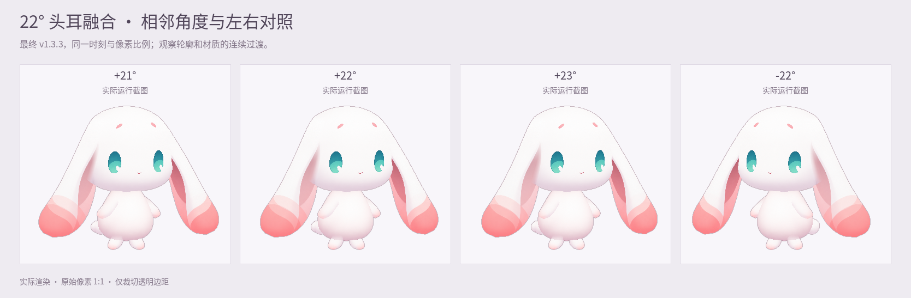
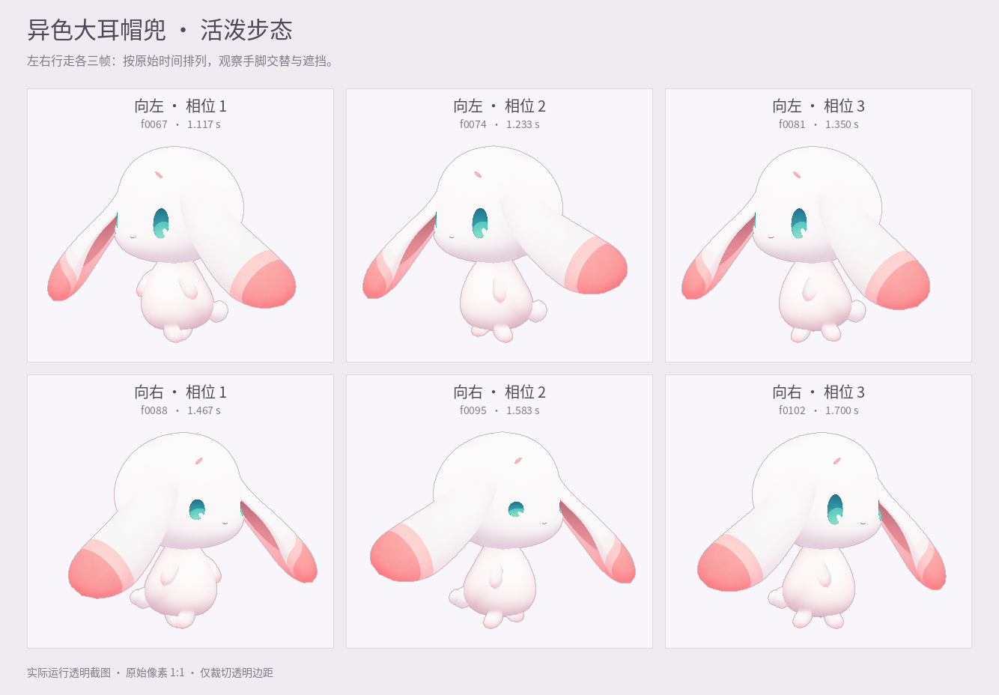

# v1.3.3 · 连续头耳融合与交替摆臂

本轮依据 v1.3.2 的实际使用反馈，修复约 22° 转向时的头耳外缘台阶、连接处扩散的旧阴影，以及左右行走时双臂仍呈同开同合的问题。沿用已选定的正面造型和现有绘画图集，调整网格连接、材质采样与走跑手臂轨迹。

本文说明实施内容与适用范围。最终发布文件、实际运行记录、检查结果和源码哈希统一见 [验收入口](../qa/acceptance.md)；安装文件与 SHA-256 见 [dist/README.md](../../dist/README.md)。

## 约 22° 的头耳外缘

上一版使用固定的短区间修整头耳肩部，区间结束时，耳朵尚未完全接管整体外轮廓。下方的旧头部分支会再次露出，让轮廓出现近乎竖直的台阶和局部不自然转折。

本版根据当前方向与耳部形状，寻找头部外缘到自由耳外缘的实际接管位置，使用连续曲线连接两端切线，并让头与耳共同遵循这条连接外缘。修整延伸到接管完成的位置，随转向平顺进入、退出；保持已有正面静态造型、侧向关键形体及耳朵自由段。

[五方向实际运行图册](../../preview/release/v1.3.3/turning-five-views.png)展示正面与左右侧向的整体形体。静态对照用于检查对应画面的轮廓，具体角度与动作检查范围以验收记录为准。

## 连接处共享连续绘画材质

方向头部切片的旧外缘本身带有紫灰色阴影。上一版将头部边界外的耳根位置钳制到这些边缘像素，导致阴影扩散到头耳接合处，影响整体融合观感。

本版把头部连接带与耳根投射到同一张干净的内部绘画材质。两侧使用相同的空间坐标场，使内部接合处避开旧切片边缘的阴影；不增加阴影层或白色覆盖片，不修改原生产 PNG。原透明度、粉色耳内、自由耳段和近侧耳朵的前向遮挡继续保留。

转向起步时，front 材质坐标在自身图集区域内连续移动，原方向材质的贡献同步逐渐退出，避免跨图集区域插值。所有头部与耳部相关顶点均填写有效材质坐标，包括权重为零的顶点。GPU 会在三角形内部插值属性，零权重顶点也必须有正确坐标，才能避免边界产生细粉线等取色异常。

正视时绕过这项方向材质修正，保留已接受的静态正面观感。材质调整只负责颜色衔接，轮廓与遮挡仍由网格及覆盖关系表达。

## 固定肩点的前后交替摆臂

原手臂形状向两侧斜伸，即使左右旋转参数互为反相，实际手爪也可能同时上抬、同时回落，视觉上仍像两边一起张合。仅检查旋转参数的符号不能说明走路姿态正确。

本版在进入走跑时，让手臂从原斜伸形状平顺过渡到肩点下垂形状，再围绕固定肩点交替前后摆动。摆动从宿主脚步恢复的同一相位生成，近远手的空间关系按朝向保持稳定；停步时连续恢复到原来的静态手臂姿态。

现有双脚交错、支撑与抬脚轨迹、落地恢复，以及耳朵跟随步伐的抬起、展开和延迟继续保留。本轮主要处理摆臂的几何与相位表达，不扩展为世界坐标锁足或地形适配。

可查看连续片段：[活泼方案左右行走](../../preview/release/v1.3.3/walking-lively.mp4) · [温柔方案左右行走](../../preview/release/v1.3.3/walking-gentle.mp4)。连续片段提供动作观感依据，不代替具体设备上的实时帧率测量。

## 安装与内容范围

| 项目 | 范围 |
| --- | --- |
| 安装包 | [Maodou-Coopanion-v1.3.3.zip](../../dist/Maodou-Coopanion-v1.3.3.zip)，保持 ZIP 格式，在 Coopanion「装扮 → 形象 → 导入」中选择 |
| 升级 | 角色 ID 仍为 `maodou-shiny`，已有同 ID 版本时按原生导入器提示替换 |
| 离线预览 | [Maodou-Offline-Preview-v1.3.3.html](../../dist/Maodou-Offline-Preview-v1.3.3.html)，保存后双击打开，内嵌角色资源与字体 |
| 运行格式 | Coopanion `manifest: 2 / api: 2` 绘画分层网格角色 |
| 表情与动作 | 保留 25 个表情、28 个动作，共 53 个词，以及「温柔」「活泼」两种性格方案 |
| 方向 | 约 −75° 至 +75° 的有限二维侧转 |
| 口型与声音 | 响应宿主的说话脉冲，声音表为空 |
| Cubism | 不包含 `moc3`、`model3.json` 或 Cubism Editor 工程 |

完整安装、源码运行与构建步骤见 [README](../../README.md)。GitHub 的 “Download ZIP” 包含整个源码仓库，应使用 `dist/` 中的角色 ZIP 导入 Coopanion。

旧宿主的指针释放处理继续按 [host-fix 说明](../../host-fix/README.md) 使用。宿主若没有转发释放或取消消息，需要应用对应宿主补丁；这个角色仓库的更新不会自动修改已有 Coopanion 安装。

## 验收与历史版本

v1.3.2 的说明和报告保留为历史记录。该版本交付后，用户继续发现约 22° 的轮廓问题、连接阴影和双臂同开同合，因此本轮重新处理相关实现。旧版报告只适用于当时的源码与检查范围，不替代本版验收。

本版的通过与未覆盖范围、画面来源和运行环境均以 [docs/qa/acceptance.md](../qa/acceptance.md) 为准。代码契约或几何数值检查不能单独证明轮廓自然、手爪可见或所有设备流畅；需要结合实际截图、连续动作与对应环境下的测量判断。

## 来源与许可

这是《洛克王国：世界》大耳帽兜的非官方角色重制。生产绘画由 GPT 图像模型生成与编辑，公开参考资料用于形体研究；本轮改动集中于现有素材的网格、材质映射和动画实现。

代码许可、角色及参考资料的权利分别见 [LICENSE](../../LICENSE)、[第三方与角色权利说明](../../THIRD_PARTY_NOTICES.md) 与 [资料来源](../../references/research-notes.md)。
