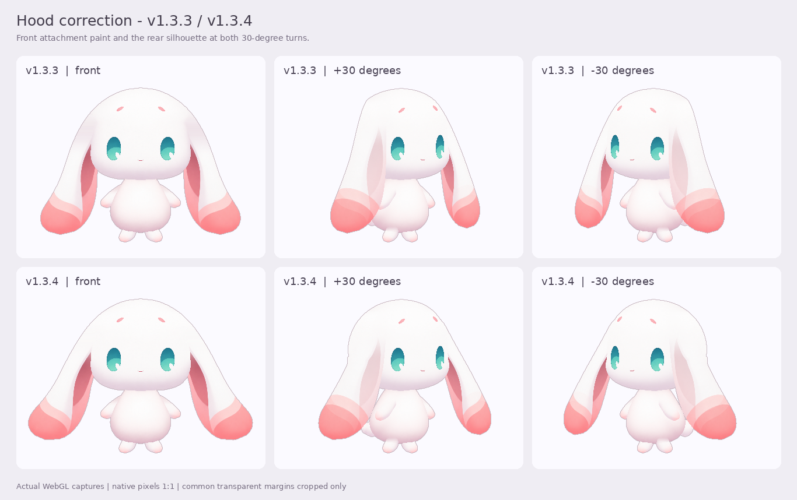
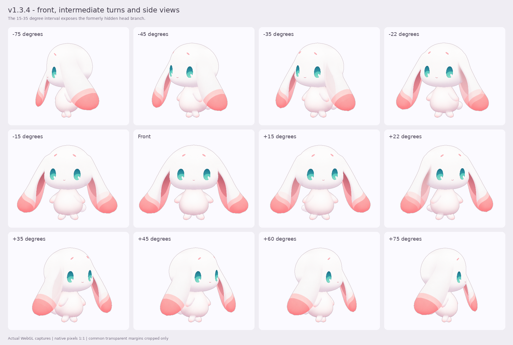

# v1.3.4 · 正面耳根材质与侧转后脑轮廓

本轮针对 v1.3.3 使用中仍出现的两处问题：正视图头部与耳根连接处的异常阴影，以及侧转时后脑畸变、后缘变平。沿用现有绘画图集和已选正面形体，分别修正附着材质与转向几何。

本文记录实施内容。发布文件、实际运行检查、画面审阅及源码哈希统一见 [验收入口](../qa/acceptance.md)；下载文件与 SHA-256 见 [dist/README.md](../../dist/README.md)。

## 正面也使用连续的头耳材质

v1.3.3 的材质修正仅在转向后启用，正面和极小转角会直接绕过，因此耳根仍可能采样到旧头部切片的边缘阴影。正面保留旧材质、转向后才替换，也使零点附近的外观依赖角度阈值。

本版取消这条绕过路径。头部附着带与耳根在正面、微小转角及侧向都使用同一片干净的内部绘画材质；相同空间位置得到相同材质坐标。两组 UV 为所有相关顶点完整填写，包括材质权重为零的顶点，避免三角形插值落入其他图集区域。

修正限定在头耳附着材质：保留原 alpha、粉色内耳、中央脸部和自由耳段的材质权重。近侧耳朵的遮挡仍由原有网格与覆盖关系控制。



## 用完整头部轮廓承接侧转

已选正面形体记录了头与耳的共同外观。其中一段头部边缘在正面被耳朵遮住，不能直接用作转向后露出的后脑。上一版又用较长的 Bézier 连接曲线修整中间转角的头耳外缘，在约 20°–40° 的方向上容易连同后脑一起削平。

本版移除这段跨越过长区域的削边处理，利用现有 `head.front` 绘画的完整轮廓构建圆润头部。低角度转向先从已选正面形体连续过渡到完整头部，再接回原有 45°、75° 方向关键形体。耳肩连接改为局部、有界的圆滑修整，使连接处理只作用于肩部附近。

这项调整处理的是二维网格在转向中露出的后脑与耳根关系。角色仍覆盖约 −75° 至 +75°，没有增加完整背视图或 360° 模型。



## 构建与回归入口

模型生成器现在从唯一生产清单 `pack/figure.json` 读取版本，避免模型版本与安装清单分离。离线预览检查的默认文件名、快速角度采样的默认输出目录也随清单版本生成，减少误用旧版文件或覆盖旧证据的机会。

本轮相关 CPU 回归入口：

```sh
node tools/check-root-material.mjs
node tools/check-hood-material.mjs
node tools/check-hood-geometry.mjs
```

材质回归检查正面附着带、角度连续性、共点 UV、零权重顶点坐标，以及几何、alpha 和自由耳段权重的保持。几何回归检查转向轮廓与局部连接约束。程序检查用于防止明确的实现退化；实际阴影、后缘形状与遮挡仍需结合运行图审阅，结果以验收入口为准。

## 安装与保留范围

| 项目 | 内容 |
| --- | --- |
| 角色安装包 | [Maodou-Coopanion-v1.3.4.zip](../../dist/Maodou-Coopanion-v1.3.4.zip)，在 Coopanion「装扮 → 形象 → 导入」中选择 |
| 离线预览 | [Maodou-Offline-Preview-v1.3.4.html](../../dist/Maodou-Offline-Preview-v1.3.4.html)，保存后双击打开 |
| 升级标识 | 角色 ID 仍为 `maodou-shiny`，安装器显示版本应为 `1.3.4` |
| 运行格式 | Coopanion `manifest: 2 / api: 2` 绘画分层网格 |
| 动作与性格 | 保留现有表情、交替摆臂、脚步、耳动作，以及「温柔」「活泼」两种性格 |
| 原图与模型范围 | 沿用现有生产绘画；本轮调整材质映射与网格连接 |

完整安装与构建步骤见 [README](../../README.md)。旧宿主指针释放问题继续按 [host-fix 说明](../../host-fix/README.md) 处理；角色安装包不会修改已有宿主应用。

## 历史记录

[v1.3.3 版本说明](v1.3.3.md) 和 [v1.3.3 验收原文](../qa/acceptance-v1.3.3.md) 保留当时的实现、检查与审阅范围。本轮用户反馈说明旧检查没有覆盖所有可见缺陷，因此不将旧版检查结果或图册作为本版通过依据。

这是《洛克王国：世界》大耳帽兜的非官方角色重制。代码及角色素材的权利范围见 [LICENSE](../../LICENSE) 与 [第三方与角色权利说明](../../THIRD_PARTY_NOTICES.md)。
